# Swiftlane

**Download videos, cut clips and edit photos in one app. No sketchy sites, no accounts.**

Ever wanted to download a YouTube video, cut a clip or edit a photo, but didn't want to install a bunch of separate programs, make accounts on online editors or click through sketchy websites? Swiftlane has all of that in one app on your PC, so you don't have to go looking anywhere else. Your files stay on your computer the whole time.

### ⬇️ Download

[**Swiftlane Setup for Windows** (latest release)](https://github.com/Lewy366/swiftlane/releases/latest). Download *Swiftlane-Setup.exe* and run it. Nothing needs installing on the phone.

> **About this project:** Swiftlane is a personal test project of mine. I directed the work, but the code itself was written by an AI (Anthropic's Claude). The source is public so anyone can check exactly what the app does. It comes as-is, with no warranty.
>
> **Ideas and feedback are welcome.** If you have a suggestion for a new feature, found something that doesn't work, or just want to comment on the project, open an issue on this repo's Issues tab. I read them all and I'm happy to hear new ideas.
>
> **All rights reserved.** There's no licence, so you're free to read the code but not to copy, modify or redistribute it without my written permission. Because of that I can't accept code contributions or pull requests, but suggestions and comments are always welcome.

Swiftlane is a toolkit for Windows. The main idea is AirDrop-style file transfer between your phone and your PC, and around that sits a bunch of everyday tools. Everything runs on your own PC. The only things that touch an outside service are the currency rates, the speed test and video downloads, and those need the internet anyway.

- **Phone transfer:** send files between your phone and this PC over your own network. You don't need to install anything on the phone.
- **Share links:** send files or folders to anyone with a link, straight from this PC (via [Tailscale](https://tailscale.com), a free-to-use app that connects your devices securely, more on that under *Share links*). You can set a time limit, download or per-person limits and an optional password.
- **Send to contacts:** if the other person has Swiftlane too, send files straight from your PC to theirs. No link, no account, no ports to open, and they always accept first.
- **Request files:** a link that lets people send files *to* you, with size and file limits and an optional password.
- **PC remote:** media keys, volume and arrow keys from your phone. It's off until you switch it on.
- **Screen mirroring:** an iPhone, iPad or Mac (AirPlay), an Android phone (Miracast) or a laptop's browser shows its screen on this PC, in a window you can make full screen. Everything is off until you switch it on, and new devices need a PIN or your OK.
- **Security tools:** an encrypted **Vault**, **Network devices** (see who's on your home network), **Is my PC exposed?**, **Startup check** (see and toggle apps that start with Windows) and **BIOS update USB** (prepare and verify a FAT32 USB stick for a motherboard BIOS update).
- **World clock:** live times on a world map with the night side shaded from the sun's real position, analog clocks for your cities, and a planner to see any moment in every time zone.
- **Find files**, **Duplicate finder**, **Storage & Cleanup** (drive map, quick cache cleaner, Downloads tidy and Steam games), **File converter**, **Image editor**, **PDF tools**, **Video trimmer**, **Shrink to size**, **Phone camera & document scan**, **QR Studio**, **Video downloader**, **Currency converter**, **Calculator** (Casio ClassWiz style), **Speed test** and **Ad blocker test**.
- Right-click any file in File Explorer and pick *Send to phone*, *Share with a link*, *Convert* or *Shrink to size*.
- Available in English, Deutsch, Polski and Italiano. You can change the accent colour and use your own background picture.
- Works in a small window too. Make it as narrow as you like (down to 400 px) and the pages stack into one column; below about 860 px the sidebar tucks away behind a ☰ menu button.

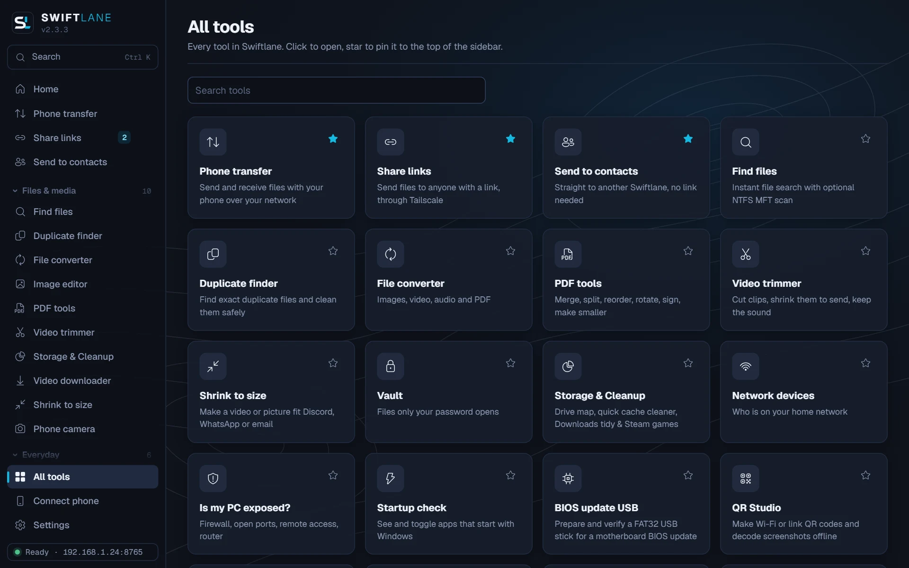

*Every tool on one page. Star the ones you use most, or press **Ctrl+K** anywhere to jump to a tool by name.*

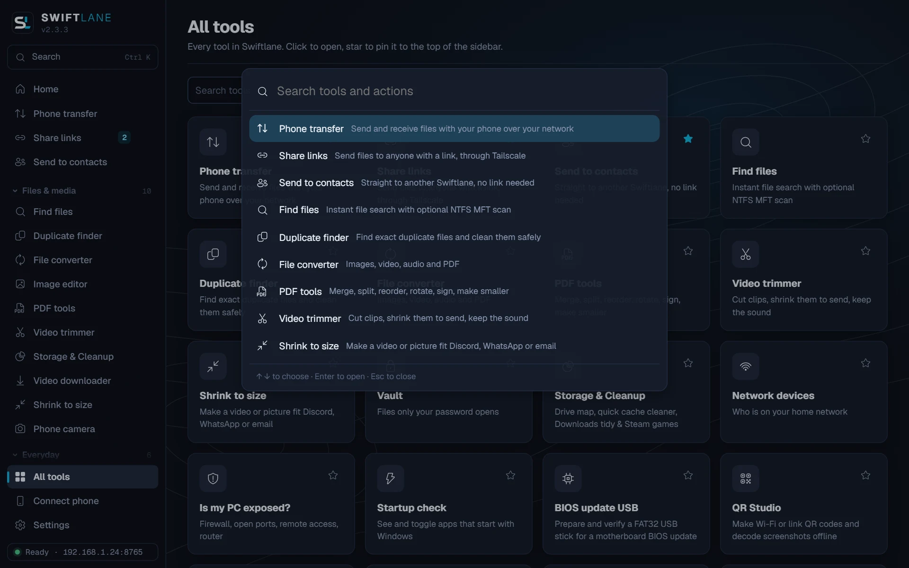

## Install

Download **Swiftlane-Setup.exe** from the [latest release](https://github.com/Lewy366/swiftlane/releases/latest) and run it (Windows will ask for admin permission). The setup wizard goes through these steps:

1. **Welcome:** if Swiftlane is already installed, you can choose *Update* (keeps your settings, pairing code and files) or *Uninstall*.
2. **Location & shortcuts:** Program Files by default, plus Start menu, desktop icon and start with Windows.
3. **Features:** pick the tools you want. It also checks for Node.js, which the video downloader needs.
4. **Your files:** where received files go, whether they get sorted into folders (Photos, Videos, Audio, Documents, Archives, Other), and where video downloads are suggested.
5. **Phone & network:** adds a firewall rule for Swiftlane only (port 8765, private networks only) and lets you choose which of your networks to mark as *Private*.
6. **Personalise:** accent colour, dark/light/auto appearance with a live preview, calculator angle unit and notifications.
7. **Ready:** a summary of your choices, then it installs and offers to open Swiftlane and pair your phone.

**Rollback:** every install step records how to undo itself. If something fails (a locked file, the firewall service, a full disk and so on), Setup reverses every step and your PC ends up exactly as it was. If you were updating, that includes the previous Swiftlane version.

## Uninstall

Go to **Settings → Apps → Swiftlane → Uninstall.** It removes everything Swiftlane set up: the program, the firewall rule, shortcuts, the Settings → Apps entry, start with Windows, your Swiftlane settings and logs, and leftovers from older versions (PocketDrop and the downloader's cache).

There's a box called **"Also delete the files Swiftlane made"** and it's **off by default**. If you tick it, only files Swiftlane created itself get deleted (received, converted, edited and downloaded files). Anything you saved there yourself is left alone, and only folders that end up empty are removed.

## The tools

### Phone transfer & Connect phone
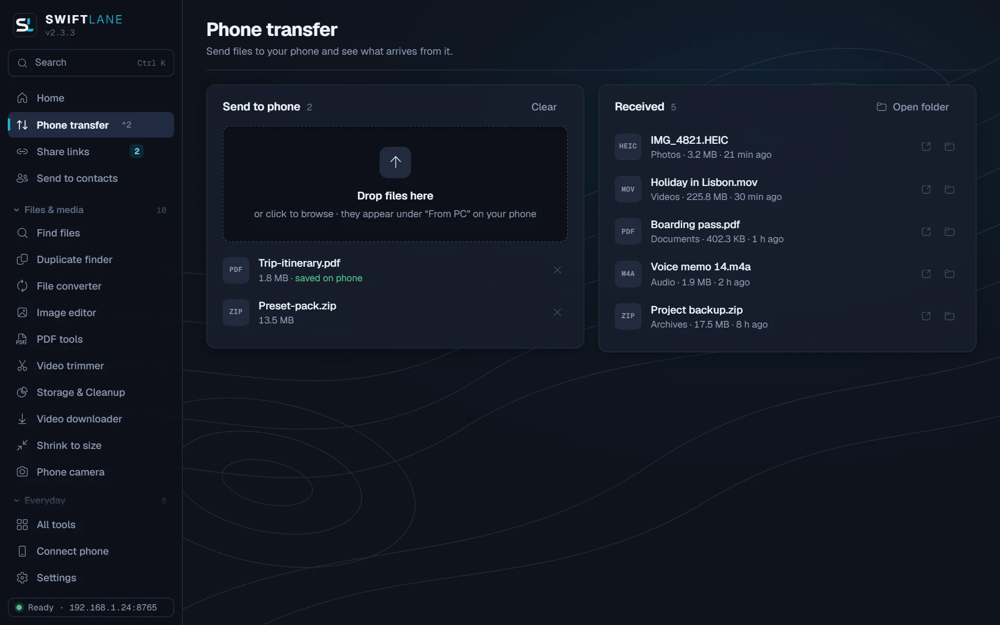

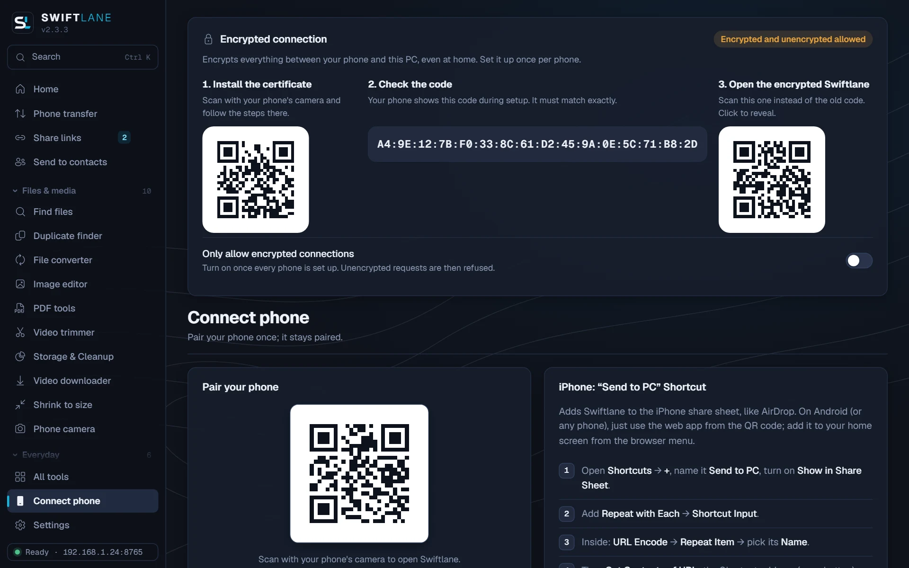

- **Connect phone:** click the blurred QR code to reveal it, then scan it with your phone's camera. That opens the Swiftlane web app, which works on iPhone and Android. Add it to your home screen if you want it to feel like a normal app.
- **Send to phone:** drag files onto the drop zone and they show up under *From PC* on your phone.
- **Received:** files from your phone arrive live, and get sorted into folders if you chose that.
- **iPhone share sheet:** make a *Send to PC* Shortcut (steps below) so you can send from any app using Share.

### Share links
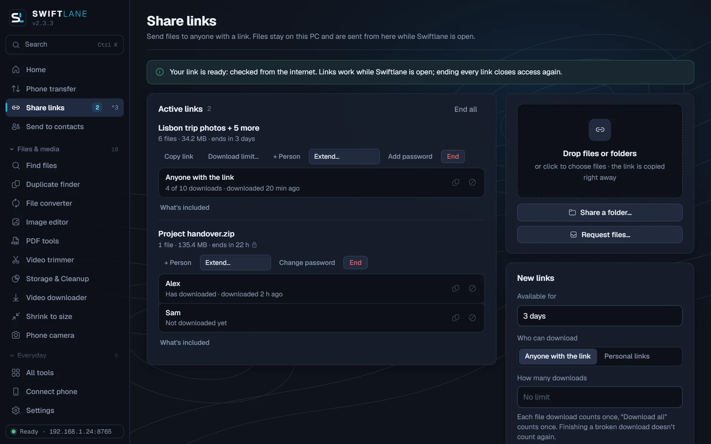

Drop files or folders onto **Share links** and the link is copied right away. Nothing gets uploaded anywhere. The files stay where they are and are sent from this PC when someone downloads them, so **this PC has to be on and Swiftlane has to be open** for the links to work. The speed depends on your internet upload speed.

- **Settings for each share:** how long it's available (1 hour to 30 days, and you can extend or end it whenever you like), and who can download. That can be *anyone with the link*, optionally with a cap on the number of downloads (change it any time with *Download limit…*), or *personal links*, which give one link per person that each person can use once. You can add people later and block one person without affecting the others. A password is optional.
- **What counts as a download** (for anyone-with-the-link): each time a file is downloaded, and *Download all* (.zip) counts once. Finishing a broken download doesn't count a second time, and chat apps opening the link to make a preview don't count either. *What's included* shows how many times each file was downloaded.
- **Personal links:** one visit can take every file, and the link is used up once that person has downloaded.
- **Folders** are listed once, when you share them. Files added later aren't included, and hidden files, system files and shortcuts/links are left out. "What's included" shows exactly what's shared. Swiftlane asks before sharing a whole personal folder or drive, or files that look private (keys, passwords, wallets), and it never shares Windows, program or app-data folders.
- **Recipients** get a plain download page that works in any browser. They can grab each file or everything as one .zip, and downloads can resume.

*What the people you send a link to see, on a phone:*

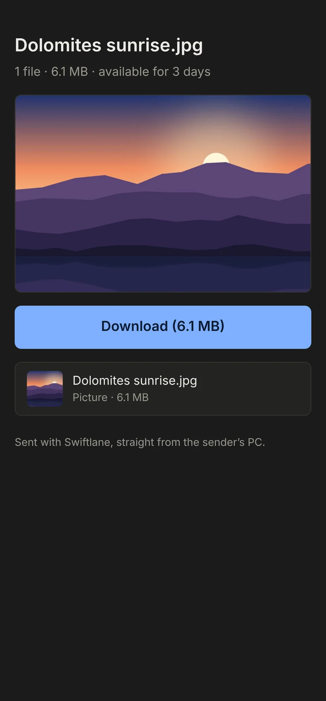 &nbsp; 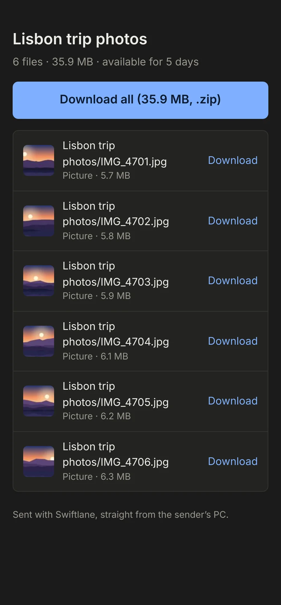

**What is Tailscale?** [Tailscale](https://tailscale.com) is an app that links your devices into your own private, encrypted network, and it has a free plan for personal use. Its **Funnel** feature can also make one service on your PC reachable from the wider internet, even for people who don't use Tailscale. That's what Swiftlane uses for share links, so you only need Tailscale on the PC that does the sharing. The people downloading don't need it, and neither does your phone for normal transfers.

- **Download it:** [tailscale.com/download](https://tailscale.com/download) (Windows, plus macOS, Linux, iPhone and Android)
- **Install guide:** [tailscale.com/docs/install](https://tailscale.com/docs/install)
- **Quickstart for first-time setup:** [tailscale.com/docs/how-to/quickstart](https://tailscale.com/docs/how-to/quickstart)
- **How Funnel works:** [tailscale.com/kb/1223/funnel](https://tailscale.com/kb/1223/funnel)

**How people reach it:** through **Tailscale Funnel**. The link looks like `https://<pc-name>.<tailnet>.ts.net/s/…`. It shows your PC's Tailscale name but not your IP or address, and no port is opened on your router. The encryption ends on your PC, so Tailscale's relay can't read the files. Swiftlane only switches Funnel **on while a link can actually be used** (plus 15 minutes after a used-up link's last download, so it can resume). It switches it **off** when the last link ends, when Swiftlane closes and when you uninstall. It never touches Funnel or Serve settings that something else created.

**Ready check:** when Funnel switches on, Swiftlane tries your link from the internet side, the way a stranger's browser would. It looks up the address in public DNS (Cloudflare, Google or Quad9, which see only the address and never the link's code), connects through Tailscale's internet entrance and checks the certificate with Windows. The Share links page says *Getting your link ready…* until that works, then *Your link is ready*. The very first time, Tailscale needs a minute or two to set up the certificate.

**One-time setup** (in your Tailscale account, the first time you share): Tailscale will ask you to turn on HTTPS certificates and allow Funnel for this PC. Swiftlane shows an *Open Tailscale* button for this. You should also turn on two-factor sign-in for your Tailscale account, because whoever controls the account controls Funnel.

### File converter
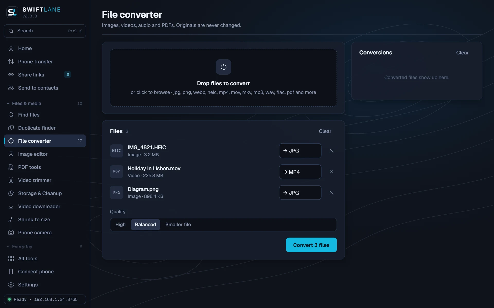

- Images: jpg, png, webp, gif, bmp, tiff, ico, avif and heic, converted to jpg, png, webp, gif, bmp, tiff, ico, avif or pdf.
- Video: mp4, mov, mkv, avi, webm and more, converted to mp4, mov, mkv, avi, webm, gif, or audio only.
- Audio: mp3, wav, m4a, aac, flac, ogg, opus and more.
- Images to PDF and back.

Quality is *High*, *Balanced* or *Smaller file*. Swiftlane asks where to save, with a "Save as" box for one file or a folder for several.

### Image editor
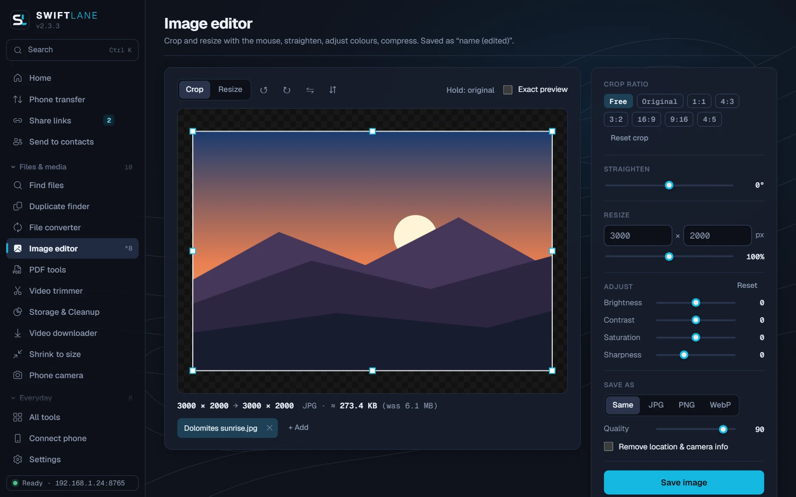

A live preview you work on with the mouse. Draw and drag a **crop** box (free or locked ratio), drag the corner to **resize**, **rotate/flip**, **straighten**, and adjust **brightness, contrast, saturation and sharpness**. You can pick the format and quality, and optionally strip location and camera info. It shows the new size and an estimated file size as you edit, and *Hold: original* and *Exact preview* let you compare before and after. Saving asks where to put the file.

### Video downloader
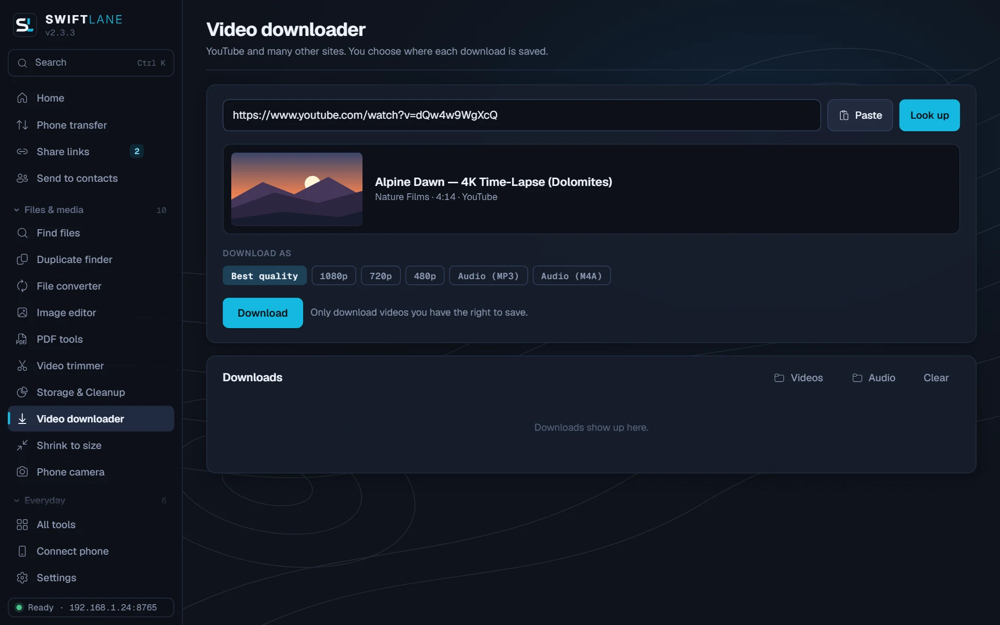

Works with YouTube and the many other sites [yt-dlp](https://github.com/yt-dlp/yt-dlp) supports. You can pick best quality, 1080p, 720p, 480p, MP3 or M4A, and download whole playlists. It asks where to save. YouTube needs Node.js for some formats. Only download things you have the right to save.

### Currency converter
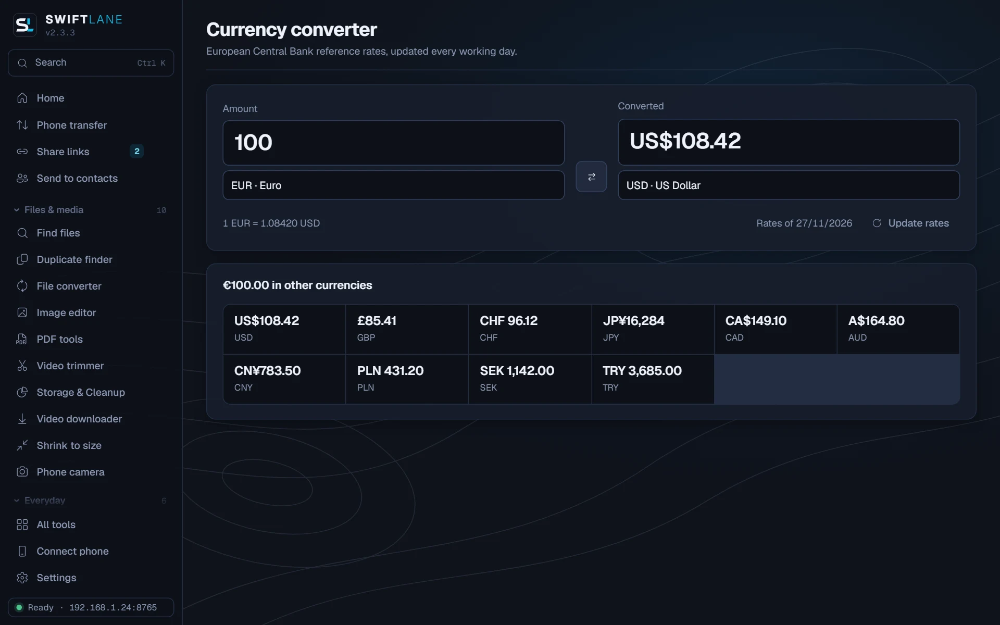

European Central Bank rates for 30 currencies, from the free Frankfurter service (no account needed). Rates refresh every working day and are kept for offline use.

### Calculator
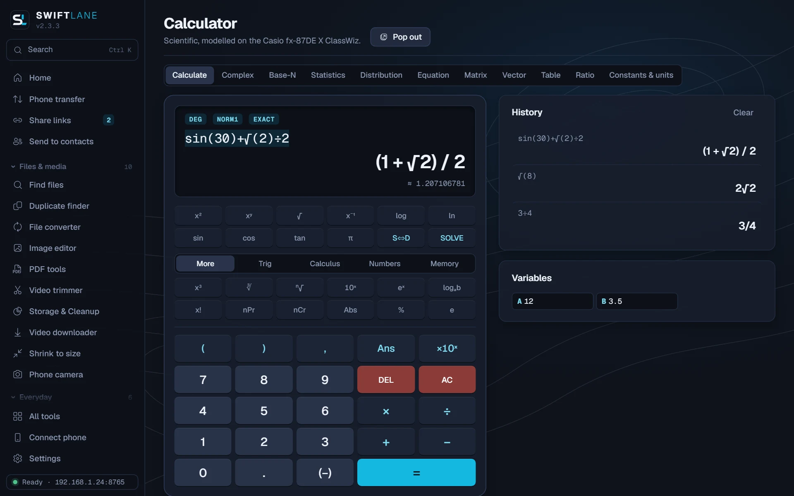

Modelled on the Casio fx-87DE X ClassWiz. It gives exact results (fractions, √, π) with **S⇔D**, Deg/Rad/Gra and Norm/Fix/Sci (click the labels on the display), and has ∫, d/dx, Σ, Π, SOLVE, variables, Ans/PreAns, M+/M−, Pol/Rec, GCD/LCM, ÷R and FACT. There are also modes for Complex, Base-N, Statistics (7 regressions), Distribution, Equation (systems, polynomials, inequalities), Matrix, Vector, Table and Ratio, plus 35 constants and 21 unit conversions.

**Pop out** opens the calculator in its own small window that stays on top of other windows (switch that off with *Keep on top*). It shares the same memory, variables and Ans as the main window, and it can only use the calculator and the clipboard, nothing else of Swiftlane.

### Speed test
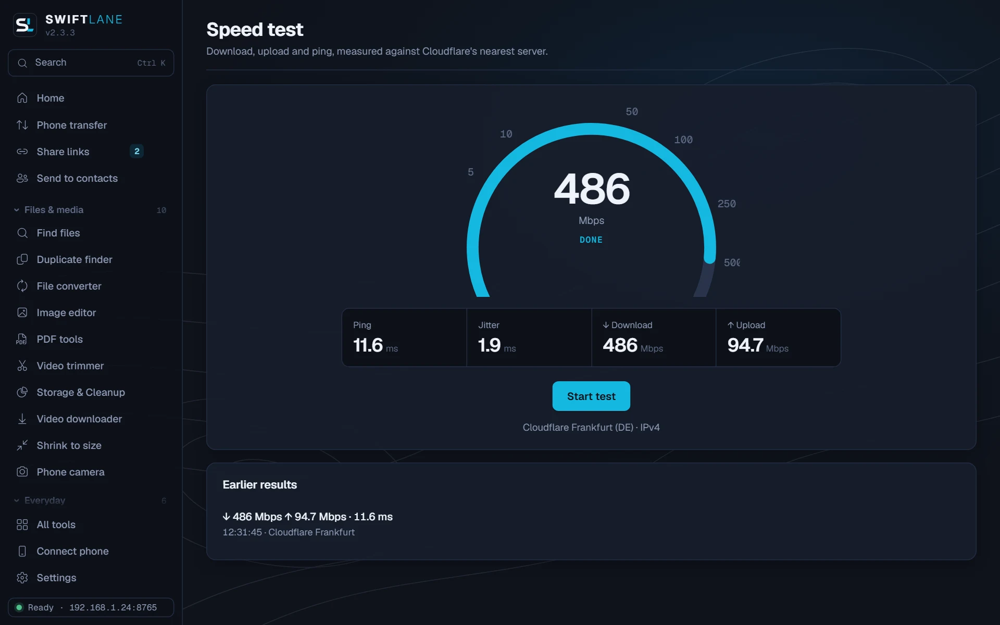

Ping, jitter, download and upload against Cloudflare's nearest server, with a live gauge. Cloudflare limits how often one connection can run a test. If you run lots in a row it asks you to wait a few minutes, and Swiftlane tells you that instead of showing a wrong result.

### Ad blocker test
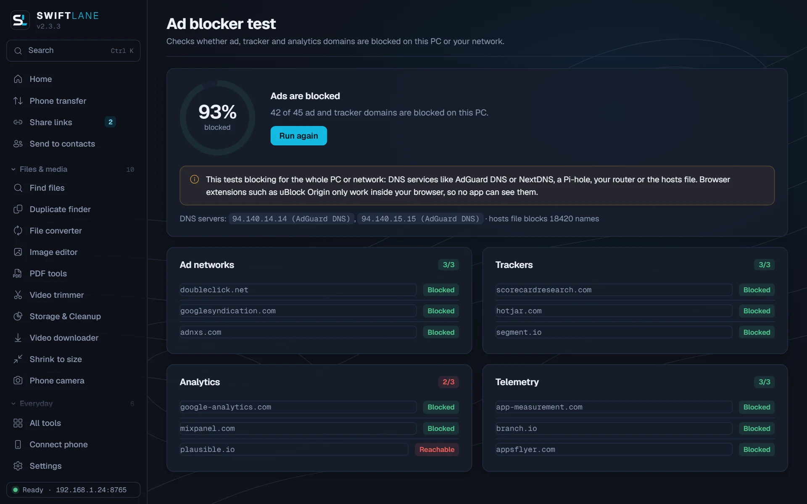

Checks about 45 well-known ad, tracker and analytics domains in six groups and shows which ones are blocked, along with your DNS servers. It tests blocking for the whole PC or network (AdGuard DNS, NextDNS, Pi-hole, your router, a hosts file). Browser extensions like uBlock Origin only work inside the browser, so no app can detect them.

### Send to contacts
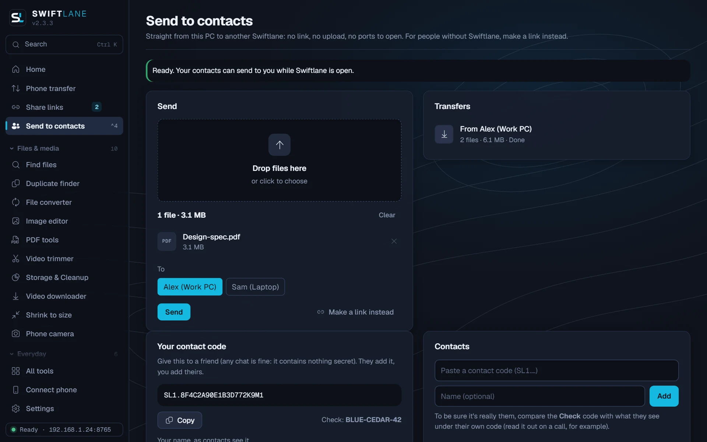

For sending to people who also have Swiftlane. Each of you copies your **contact code** from *Send to contacts* and adds the other's (any chat is fine, the code contains nothing secret). To be sure you added the right person, compare the short **Check** code you see next to their name with the one under their own code. After that, drop files, pick the contact and press **Send**. Their Swiftlane shows who's sending what and how big, and nothing arrives until they click **Accept**. Files go to their Received folder, sorted like phone transfers. Both PCs need to be on with Swiftlane open. For people without Swiftlane, *Make a link instead* hands the files to **Share links**.

**How it connects:** each PC has its own identity key (locked to your Windows account), and the contact code is its public half. Swiftlane uses [iroh](https://iroh.computer) to find the other PC by that key and connect straight through both routers, so nobody has to open ports. If a direct path isn't possible, the data goes through an iroh relay server, still end-to-end encrypted so the relay can't read it. iroh's servers do see which IP addresses connect, and when. The connection only runs while you have at least one contact, and anyone who isn't one of your contacts is turned away without an answer.

### Request files
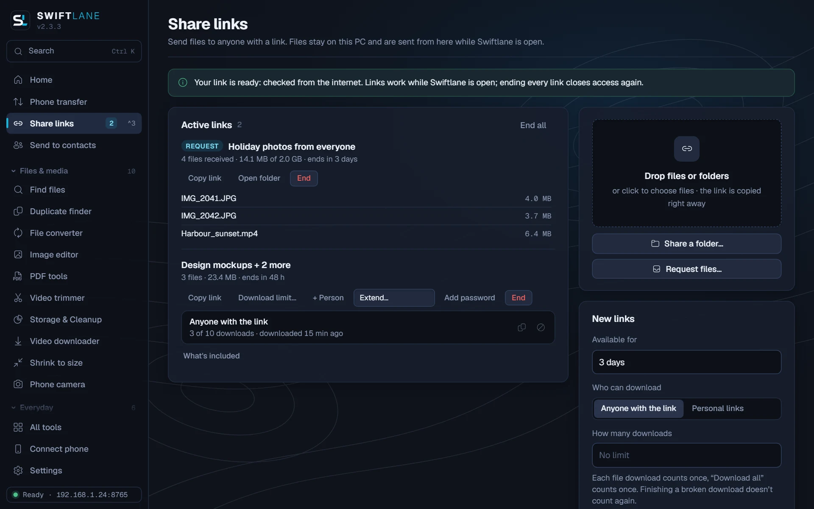

On **Share links**, *Request files* makes a link that other people can use to upload files into a folder you pick. You set how long it works, the maximum number of files and the biggest total size, and you can add a password. The link only accepts uploads. It never shows or offers anything already in the folder or anything others have sent. Received files are marked as coming from the internet (so Windows warns before running them) and they never overwrite anything.

*What people see when they open your request link:*

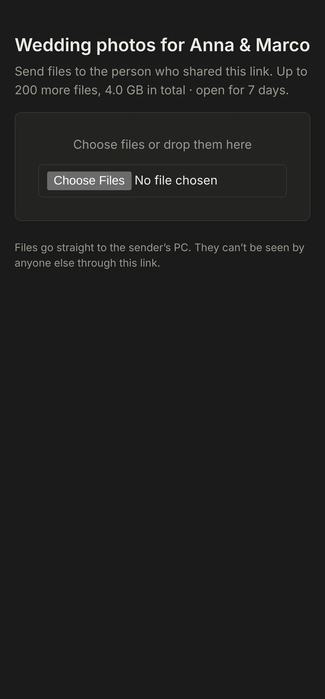

### World clock
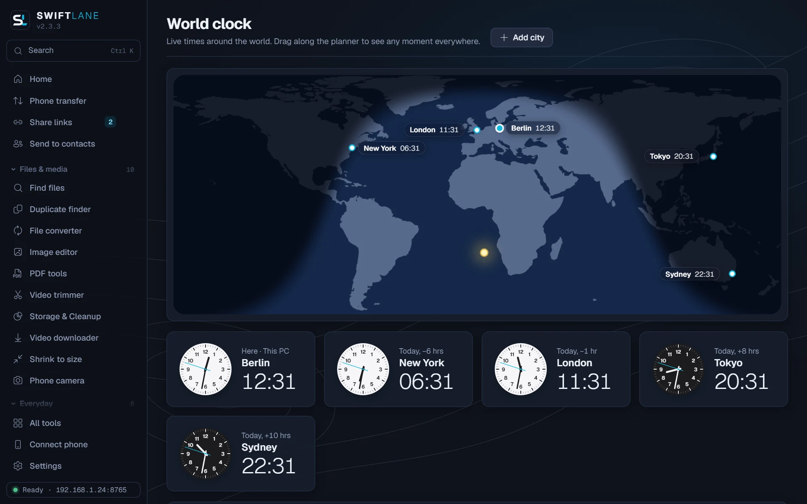

A world map with the night side shaded from where the sun actually is right now, including a soft twilight band and a marker where the sun is overhead. Your cities show as pins with their time, and as cards with an analog clock (light by day, dark at night), the time difference to you, and whether it's today, tomorrow or yesterday there. **Plan a time** lines up 24 hours for every city (working hours light, night dark). Drag along it and every clock and the map jump to that moment, and *Back to now* returns to live time. Everything is calculated on your PC from Windows' own time zone data, so daylight saving is always right. Nothing goes online. Map outline: [Natural Earth](https://www.naturalearthdata.com) (public domain).

### Screen mirroring
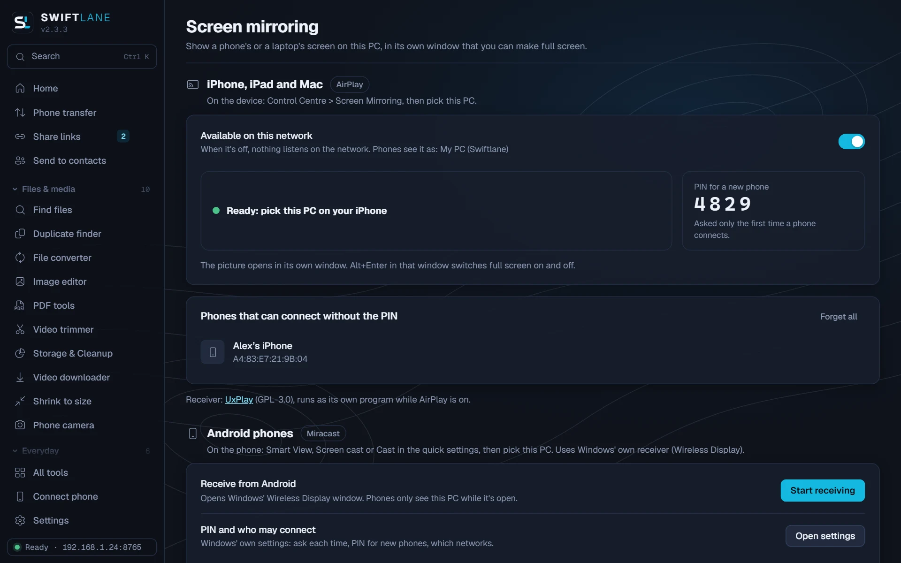

A phone's or a laptop's screen on this PC, in its own window that you can make full screen. One page, three ways in:

- **iPhone, iPad and Mac (AirPlay).** On the device, open Control Centre > Screen Mirroring and pick the PC. Alt+Enter in the picture's window switches full screen on and off. The first time you use it, click *Download and install* (a one-time 77 MB download), and Windows asks for permission once, to install the receiver and let it through the firewall on home networks. After that, switch on *Available on this network*. Each new device types the 4-digit PIN shown on the page (and in a notification) once, and after that it just connects. *Forget all* makes every device type the PIN again. The receiver is the open-source [UxPlay](https://github.com/FDH2/UxPlay), and it only runs while the switch is on and Swiftlane is open.
- **Android phones (Miracast).** On the phone, use Smart View, Screen cast or Cast in the quick settings, and pick the PC. This uses Windows' own receiver, *Wireless Display*, a free part of Windows. *Set up Wireless Display* installs it from Windows Update (Windows asks for permission once), *Start receiving* opens it, and *Open settings* goes to Windows' own choices for the PIN and who may connect. It needs a PC with Wi-Fi that supports it (Swiftlane checks), and how well it works depends on the phone: Samsung's Smart View works well, while some other phones don't offer Miracast at all.
- **Laptops and computers (from the browser).** Windows, Mac, Linux or Chromebook: switch on *Allow casting from a browser*, open the link (or scan the QR code) on the laptop in Chrome, Edge, Firefox or Safari, and click *Share screen*. The browser asks what to share (the whole screen, a window or a tab, with sound if you like), and Swiftlane asks you *Allow* or *Deny* before anything shows. Double-click or F11 in the picture's window switches full screen, and Esc goes back to a window. Nothing gets installed on the laptop. The first time, the browser warns about the certificate, because it's Swiftlane's own; the page shows the fingerprint to compare. Phones can't do this, because their browsers can't share their screen.

### PC remote
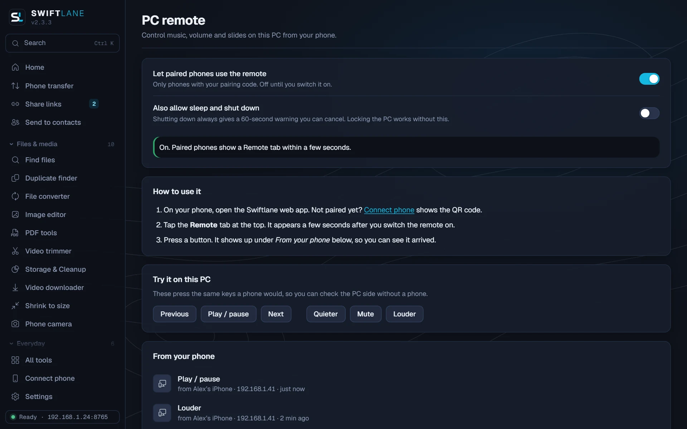

Off until you switch it on in Settings. After that, paired phones get a *Remote* tab with play/pause, next/previous, volume, mute and arrow keys (handy for slides). Sleep and shut down sit behind a separate switch, and shut down waits 60 seconds and can be cancelled.

### PDF tools
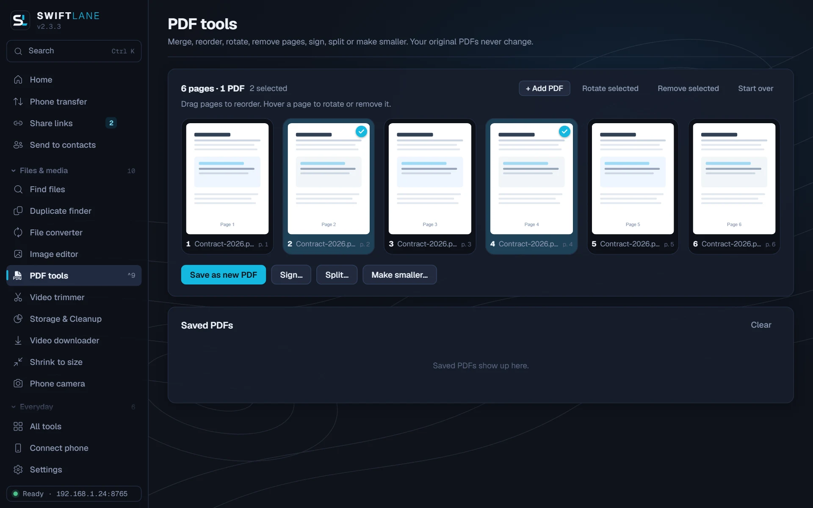

Drop in one or more PDFs and the pages show up as a board. You can reorder them by dragging, rotate, remove and select pages. From there you can save as a new PDF (several PDFs get merged in order), **split** (selected pages start new parts, or every page on its own), **sign** (draw your signature or use a picture, then click where it goes) or **make smaller** (this turns pages into pictures). Your original files are never changed.

### Video trimmer
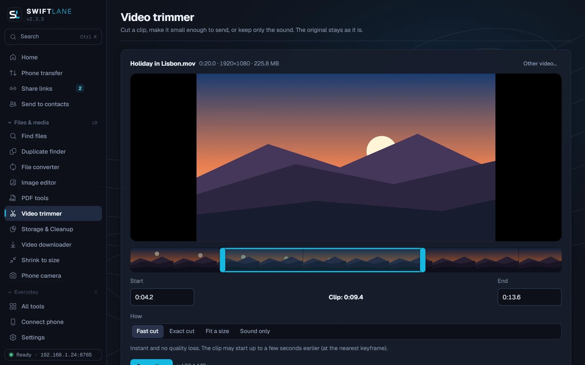

Pick the start and end on a filmstrip. Your options are *Fast cut* (instant, no quality loss, starts at the nearest keyframe), *Exact cut*, *Fit a size* (Discord 10 MB, email 20 MB, WhatsApp 64 MB or your own) and *Sound only* (MP3).

### Shrink to size

Drop a video or picture (or right-click it in Explorer and pick *Shrink to size with Swiftlane*), choose *Discord (10 MB)*, *WhatsApp (16 MB)*, *Email (25 MB)* or your own limit, and Swiftlane makes it fit. Before it starts you see what you'll get (video bitrate and size). If a long video would look rough, it says so plainly and offers to *trim it first* in the Video trimmer. Videos are encoded in two passes with a safety margin and checked afterwards; pictures become JPEGs (or stay PNG if that already fits) with the quality lowered first and the size only if needed. When it's done the file is on the clipboard, so Ctrl+V pastes it in Discord, WhatsApp Desktop or Explorer. *Save as...* and *Show in folder* are there too. MB means 1,000,000 bytes, so the result fits however the other side counts.

**Security:** the original is only read, never changed or replaced. Results go to a private temporary folder that is emptied when Swiftlane starts and closes, and only files from that folder can be copied or saved from the page. Metadata such as GPS location is left out of the result.

### Phone camera & document scan
On the phone page, *Camera / Scan* opens the phone's own camera app (nothing is streamed). Each photo goes to the PC over the normal paired connection and appears in *Phone camera* as a thumbnail, with *Take another* / *Done* on the phone for several shots in a row. Pictures already on the PC work too: click *Add pictures from this PC…* or drop them on the page (a copy is used; the original is never changed). For each photo: *Use as photo* saves it as a JPG in your save folder (a JPG is kept exactly as it arrived, like any other transfer), or *Scan document* shows it with four draggable corners (with a magnifier while you drag, so you can place them exactly). Swiftlane flattens the page from those corners (perspective correction), and you can choose *Original colour*, *Grayscale* or *Black & white* and turn it in 90° steps. Corners are never applied automatically; they start just inside the photo's edges. Add the pages to the scan tray, put them in order, then save as JPG, as one new PDF, or as a new PDF that adds them after an existing one.

**Security:** photos use the same upload route as every other file: pairing code, 15-minute lockout after 10 wrong tries, and a Content-Length check, with a smaller 40 MB limit per photo and at most 60 waiting. They only count as pictures if their first bytes say so, and their decoded size is capped (64 million pixels) so a crafted file can't use up memory. Photos wait in a private temporary folder that is deleted when Swiftlane closes (and left-overs of a crash are swept away). Nothing reaches your save folder until you click. Scans are re-encoded pictures, so they carry no camera or location data; the PDF you add to is only read and the result is always a new file you name in the Save box.

### Storage & Cleanup
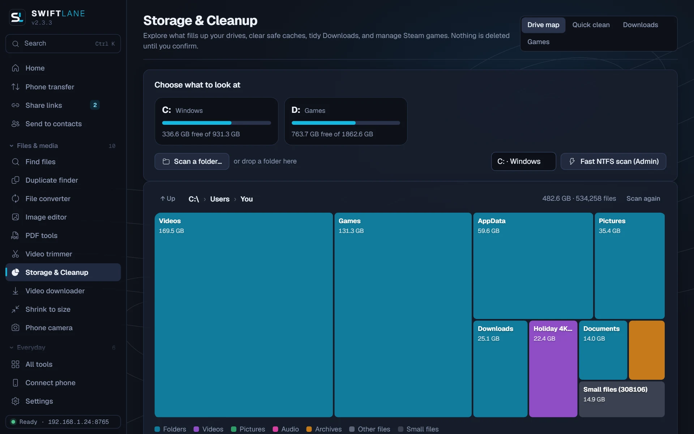

Pick a drive or folder and see what's taking up the room as an interactive map of blocks you can click into (with an optional fast NTFS scan for whole drives), plus a list of the biggest files and a **Cleanup Advisor** with quick cache cleaning, Downloads tidy-up and Steam game size overview. Junctions and links aren't followed, so nothing gets counted twice. *Move to the Recycle Bin* is used so removed files can be restored, and system or program folders are never offered for deletion.

### Find files

Search for files across your drives in real time by name, extension or size, with an optional fast NTFS scan (asks for admin permission once) to index a whole drive in seconds.

### Duplicate finder

Scan folders for exact byte-for-byte duplicate files, review every group side by side, and safely move unwanted copies to the Recycle Bin.

### Startup check

See every app configured to start when you sign in to Windows and toggle them on or off without digging through Task Manager or the registry.

### BIOS update USB

Prepare a FAT32 USB stick for updating your motherboard's BIOS without guesswork. Swiftlane detects your motherboard model, revision and current BIOS version (and links you to the manufacturer's support page, or lets you pick another vendor if you are preparing a stick for a different PC). Drop the BIOS zip or image you downloaded, pick **In-BIOS updater** (such as M-Flash, EZ Flash, Q-Flash or Instant Flash) or **Flashback button** (which sets the expected filename for rear-button flashing), choose your FAT32 USB stick, and Swiftlane copies the BIOS file, verifies it on the stick, and lets you safely eject it with vendor-specific steps to finish in UEFI/BIOS.

**Safety:** Swiftlane never flashes your BIOS from Windows, never downloads BIOS files automatically, and never runs vendor executables (such as `BIOSRenamer.exe`) inside a zip. Only removable USB sticks are listed (never fixed or system drives), every copy is checked by reading the file back from the USB stick to verify its SHA-256 checksum, and you get clear warnings when BitLocker is active on C: (so you back up your recovery key first) as well as a reminder never to power off or unplug the PC while flashing.

### QR Studio

Create Wi-Fi, link or text QR codes and export them as PNG or SVG, or paste a screenshot / drop an image to decode a QR code completely offline.

### Vault
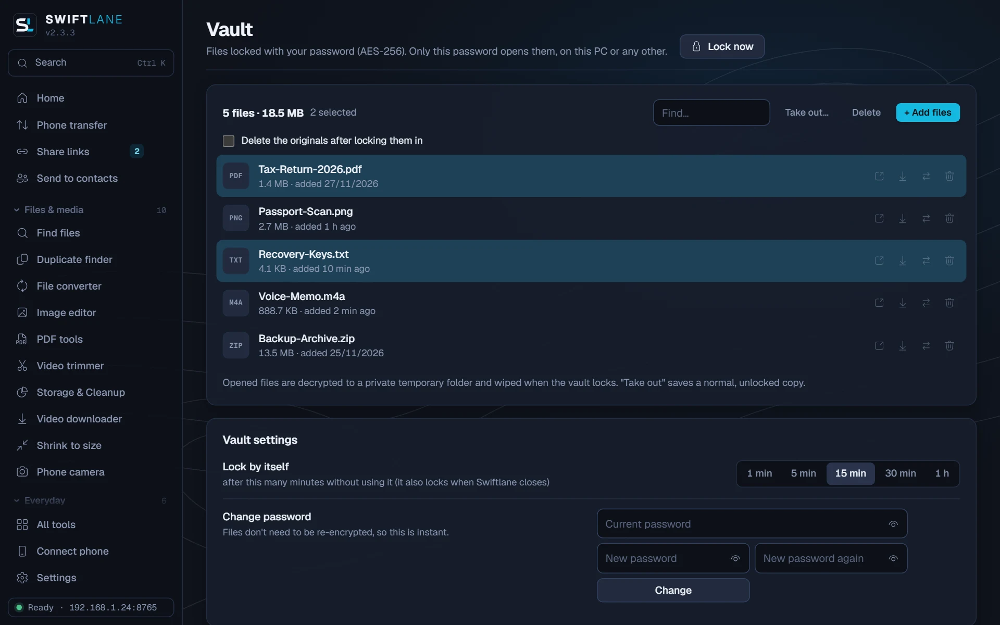

Files locked with your password. A random 256-bit key encrypts every file with AES-256-GCM in 1 MB pieces. Your password (stretched with scrypt) only unlocks that key, so changing the password is instant. File names are encrypted too. Each piece is tied to its file and its position, so a changed, swapped or cut-off file refuses to open instead of handing back damaged data. Opened files go to a private temporary folder that's wiped when the vault locks, which happens after a few quiet minutes and whenever Swiftlane closes. **There is no password recovery.** The vault is just a normal folder, so you can back it up or put it on a USB stick and open it on another PC with Swiftlane.

### Network devices
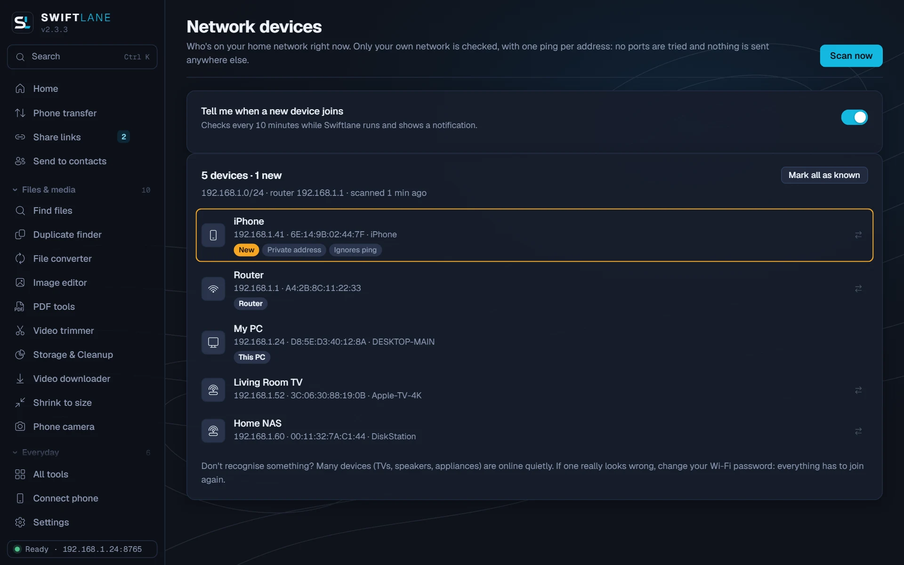

Shows who's on your home network: the name (from your router), the address, the hardware address, and whether it's the router, this PC or a phone using a private address. Only your own private /24 network is checked, with one ping per address plus Windows' own address table, and no ports are tried. Devices are remembered on this PC, so new ones get marked and you can give them names. If you want, Swiftlane can check every 10 minutes and notify you when a new device joins.

### Is my PC exposed?
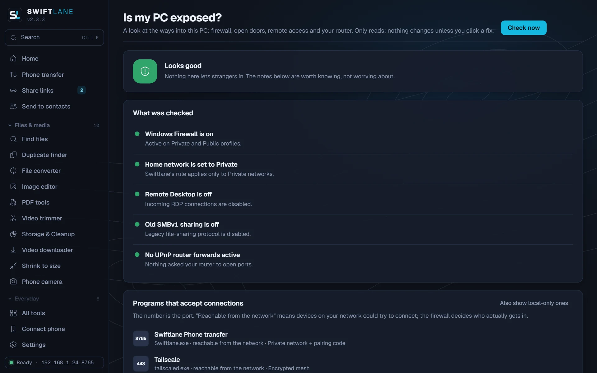

A read-only check. It looks at whether the firewall is on, whether this network is Public or Private, whether Remote Desktop or the old SMB1 file sharing is on, which programs accept connections from the network (and what they are), whether your router opens ports to the internet on its own (UPnP) and which ones, and what Swiftlane itself has open. Fixes are buttons you click, and any change to Windows asks for admin permission.

### Settings
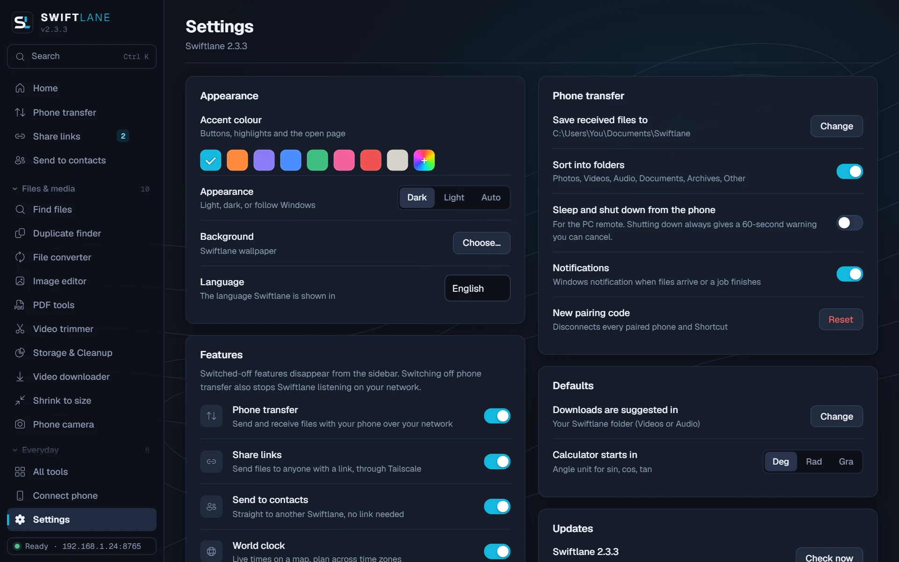

Appearance (accent colour, background picture with blur and darkening, language), turning features on and off (switching off phone transfer stops Swiftlane listening on the network), where received files go and how they're sorted, notifications, a new pairing code, the default download folder, the calculator angle unit and start with Windows.

**Light or dark:** pick *Light*, *Dark* or *Auto* (follows Windows).

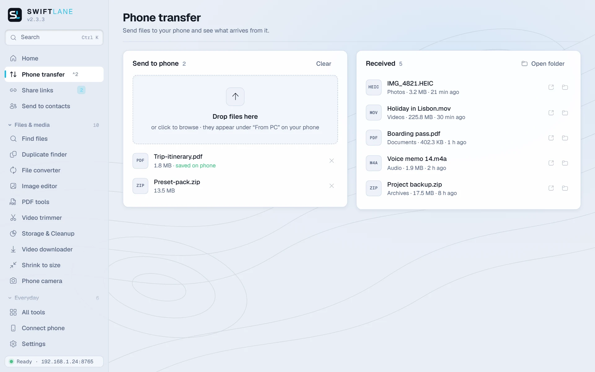

**Updates:** Swiftlane checks for a new version every time it starts, then every 30 minutes while it's open. When one is out, a window shows what's new, and nothing is installed until you click *Update now*. Updates are only installed if they carry the owner's signature.

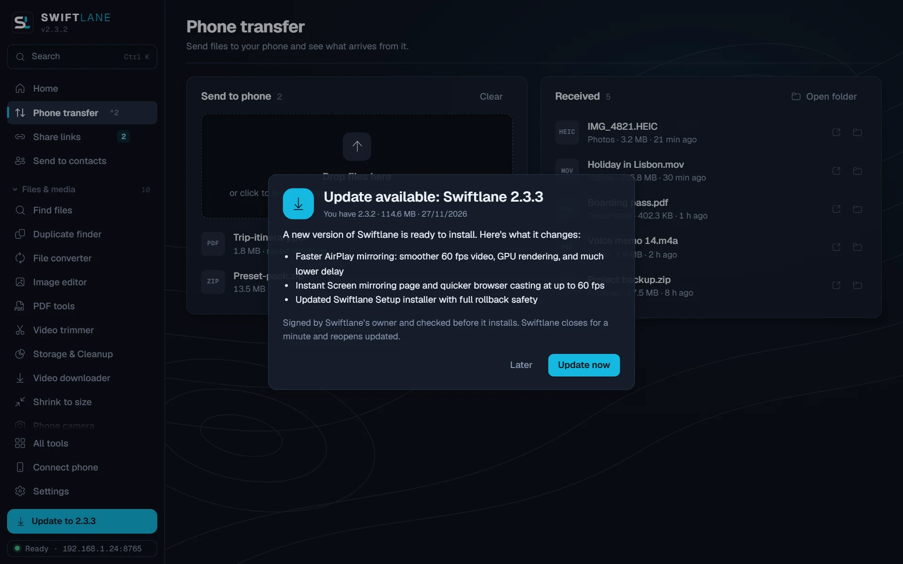

## iPhone "Send to PC" Shortcut

1. Open **Shortcuts**, tap **+** and name it **Send to PC**. In its details, turn on **Show in Share Sheet**.
2. Add **Repeat with Each** and set it to **Shortcut Input**.
3. Inside it, add **URL Encode** with **Repeat Item**, then tap Repeat Item and pick **Name**.
4. Below that, add **Get Contents of URL**. For the URL, use the Shortcut address from *Connect phone* (there's a copy button), then add the **URL Encoded Text** variable after `name=`. Tap **Show More**, set the Method to **POST**, add a header `X-Token` with your pairing code, and set Request Body to **File** with **Repeat Item**.

The first time you run it, iOS asks whether to let Shortcuts find devices on your local network. Say yes.

## Security

- The firewall allows port 8765 for the installed Swiftlane.exe only, and only on private networks. The exe sits in Program Files, which only admins can change, and it claims the port exclusively.
- Every phone request needs the pairing code. An address is locked out for 15 minutes after 10 wrong tries, and only private-network and Tailscale addresses are accepted.
- Download links for PC to phone files are signed and expire after 10 minutes.
- Received file names are cleaned up, nothing gets overwritten and partial uploads are deleted.
- Phone transfer can be encrypted (HTTPS). Swiftlane makes its own certificate authority, limited by name constraints to private and Tailscale addresses (so it can't vouch for any website), and its key is protected by Windows (DPAPI). Install it on your phone once from *Connect phone*, and then *Only allow encrypted connections* refuses plain HTTP.
- Send to contacts: end-to-end encrypted (QUIC with each PC's own key). Only keys in your contacts get in, the receiver always accepts first, every file is checked with SHA-256 and broken or cancelled files are deleted. Received files get the "from the internet" mark and never overwrite anything. iroh's discovery and relay servers see connection metadata (IP addresses, timing), never file contents.
- Request links only accept uploads, within the limits you set. Uploads are written to a temporary file and only kept once complete, and received files get Windows' "from the internet" mark.
- Phone camera photos use the normal authorized upload (no extra route), are size- and count-limited, checked as real pictures, kept in a private temporary folder deleted on exit, and never saved anywhere until you click. Scans carry no camera or location data.
- PC remote is off by default, needs the pairing code, only accepts a fixed list of keys and is rate-limited.
- AirPlay uses [UxPlay](https://github.com/FDH2/UxPlay) (GPL-3.0), built from its source. It's a one-time download that Swiftlane only installs if its integrity check matches. It goes into its own Program Files folder (admins only), and its firewall rule covers only the AirPlay receiver on private networks. It runs only while AirPlay is switched on and Swiftlane is open: Windows ends it together with Swiftlane, even after a crash. A new phone must type a 4-digit PIN once, and *Forget all* takes that back.
- Miracast is Windows' own Wireless Display receiver: Swiftlane only installs it (from Windows Update), opens it and links to its settings. It adds nothing of its own that listens on the network. Windows brings its own firewall rules for it, and phones only find the PC while its window is open.
- Casting from a browser runs only while you have it switched on, and it switches off when Swiftlane closes. The link carries a random code that's new every time you switch it on (it's separate from the phone pairing code), and wrong codes count towards the same 15-minute lockout. Every cast waits for you to click *Allow*. At most 3 requests can wait at once, and they expire after 2 minutes. The picture goes straight from the laptop's browser to Swiftlane's window over WebRTC, which is always encrypted, with no outside servers. Swiftlane replaces the addresses in the connection details with the one the request actually came from, so the picture can't be steered anywhere else. The cast page only works over the encrypted (HTTPS) connection.
- The vault never stores or sends your password. See *Vault* above for how files are encrypted.
- Network devices only pings your own home /24 network. Is my PC exposed? only reads, and talks to nothing except your router (and only at its own address).
- Share links run on a separate small server that listens on this PC only (127.0.0.1:8766). It's reachable from outside only through Tailscale Funnel, and only while something is shared. It's download only, links are random 128-bit IDs and never contain file paths, pages have no scripts and every file is sent as a download. Passwords are stored as scrypt hashes, and 5 wrong tries from one address (40 on one link) means a 15-minute wait. There's a limit of 48 connections at once. Keep in mind that anyone who downloads a file can pass it on: the limits control the link, not the file.
